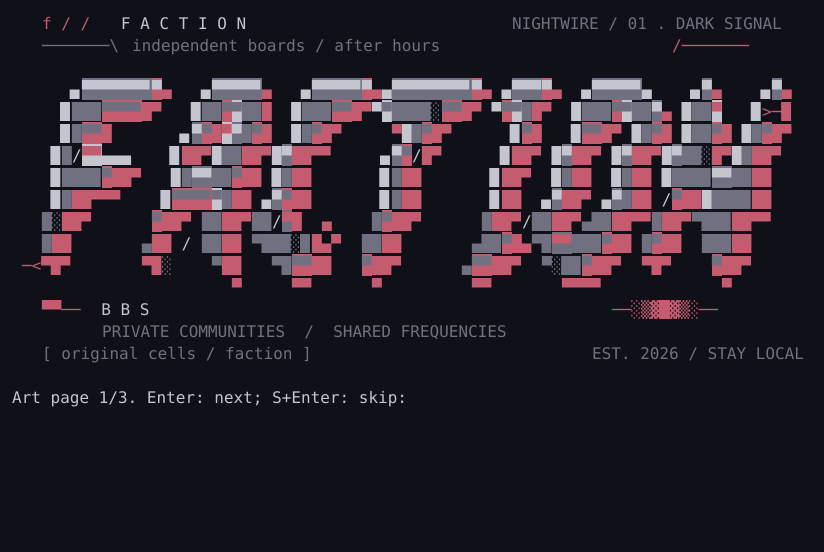

# Faction BBS

**Independent boards. Private communities. Shared frequencies.**

Faction is a terminal-first BBS for communities run by their own sysops: ANSI
identity screens, custom menus, Citadel-style message rooms, files, late-night
chat and game doors. It brings the spirit of WWIV and the underground BBS scene
to a Rust foundation, with NetBSD as its primary target.

Connect over SSH, use arrows or hotkeys, and make yourself at home. Each board
owns its membership and content. A sysop can keep it on a private network without
a public website or central service.



*Original Nightwire artwork: angular steel/red lettering, abstract motifs and
coordinated seasonal variants. This is a reference-cell preview; terminal palettes
and fonts vary. Explore the [artwork](docs/artwork-nightwire.md) and
[sysop theme system](docs/theme-packs.md).*

## Status

**Working hobby preview · updated 2026-11-07 · no supported release yet.**

The local BBS core and restricted SSH service work. Optional features are enabled
by the sysop; experiments and future protocols are separate from normal operation.

- **Platform:** software validation on a NetBSD 11 ARM64 VM, with macOS development
  and terminal checks. Physical SBCs and other NetBSD ports remain untested.
- **Capacity:** the normal shared service admits **eight sessions**. Earlier
  250-member experiments are [research evidence](dev-docs/research/README.md),
  not supported capacity.
- **Privacy:** the [offline vault](docs/local-mail-vault.md) and optional
  [manual encrypted home mail](docs/online-mail.md) keep keys and decryption on
  the member's device. The native client offers a local inbox, explicit replies,
  multiline composing, paged bodies, deliberate [inbox home exchanges](docs/local-mail-inbox.md#exchange-home-mail-without-leaving-your-place),
  bounded archive catch-up, a separate brief foreground exchange and a
  [private attachment desk](docs/private-attachments.md).
  Compatible home storage is required. Ordinary SSH access does not receive private
  mail plaintext or keys. Classic and Unicode two-client host tests with synthetic
  TLS homes exercised the new exchange and later archive recovery. Classic and
  Unicode host and NetBSD 11 ARM64 software VM journeys also exercised fresh
  conversation writing and selected queued-text exchange. NetBSD checks covered
  same-SSH BBS/SFTP outage, privacy and return at 1 GiB runtime.
- **Limits:** provider operation and cross-home attachment delivery are software
  previews, not deployed services. An explicitly enabled own-home route completed
  maximum-size classic and Unicode exercises on the host and a NetBSD software
  VM, using two separately configured homes and one opaque test delivery/archive
  queue. Deployed federation, independent client interoperability, physical
  hardware and capacity remain unqualified. See the
  [operator guide](docs/provider-operator.md) and
  [carrier contract](dev-docs/delegation-verifier.md) and
  [software evidence](dev-docs/evidence/own-home-attachments/README.md). The bounded
  waiting-collection extension has separate
  [host qualification](dev-docs/evidence/bounded-resource-collection/README.md),
  including maximum-file console checks. Separate
  [NetBSD 1 GiB software checks](https://github.com/gonz0w/faction-bbs/issues/326#issuecomment-6581115822)
  at `5ca3e7b` passed both classic and Unicode maximum-file journeys. Historical
  deadline failures and their unresolved cause remain tracked in
  [#326](https://github.com/gonz0w/faction-bbs/issues/326); the later
  [rebalance and diagnostics](https://github.com/gonz0w/faction-bbs/pull/353)
  passed the required checks.

## What you can do

| Area | Working preview |
| --- | --- |
| Login and identity | Registration, local sysop approval/revocation, hidden passwords, [ANSI/lightbar menus](docs/theme-packs.md), seasonal screens and compact/plain fallback. |
| Discussion rooms | [Room browsing](docs/room-browser.md), unread navigation, subjects/replies, [paged reading](docs/room-reading.md), [full-screen writing and saved drafts](docs/writing-desk.md), [search and bookmarks](docs/discussion-search.md). |
| Chat and callers | [Local IRC-style chat](docs/local-chat.md), a distinct [Who list](docs/who-and-presence.md), shared availability/visibility and [polite paging](docs/social-lounge.md). |
| Other boards | [Local directory](docs/other-boards.md), private member submissions and sysop publication review; every destination keeps independent admission. |
| Community | [Wall](docs/community-wall.md), [member pages](docs/member-pages.md), [gatherings](docs/gatherings.md), [polls](docs/polls.md) and [personal catch-up](docs/catchup.md). |
| Files | [File areas and restricted SFTP](docs/file-areas.md), private-area grants, upload review, permission-checked room/chat links, [library shelves](docs/library-shelves.md) and [file requests](docs/file-requests.md). |
| Arcade | [Lua menus and two original games](docs/lua-doors.md), persistent high scores and an optional [classic server connector](docs/classic-game-doors.md). |
| Creative scene | [ANSI/ASCII galleries](docs/scene-gallery.md), [local magazines](docs/board-magazine.md) and a [contributor approval workshop](docs/magazine-workshop.md). |
| Native client | [Integrated transfers](docs/native-client.md), a [board picker](docs/board-launcher.md), [connection desk](docs/connection-desk.md), [local passport](docs/local-passport.md), an [offline encrypted vault](docs/local-mail-vault.md) and optional [manual encrypted home mail](docs/online-mail.md). |
| Sysop operations | [Local stats console](docs/sysop-console.md), CPU/RAM/network graphs, service health, [backup checks](docs/backup-checks.md) and [export/restore](docs/export-restore.md). |

The main-menu [board guide](docs/board-guide.md) provides ANSI **F1** and plain
`help`. Classic ANSI remains the default. Optional [Unicode text and terminal
capabilities](docs/terminal-capabilities.md) and a bounded
[Kitty image preview](docs/kitty-graphics.md) use explicit settings and capability
probes; a terminal brand alone never enables them.

Original **[LORD 4.06](docs/original-lord.md)** also ran through the SSH doorway on
a separate NetBSD game VM, with saved progress. That is a private reuse proof,
not a bundled or supported game launcher. Further emulator/game expansion and
TWGS publisher activation remain deferred.

## Run a local board

Use Rust **1.96+**, a native C compiler for bundled SQLite, and a real Unix
terminal. Python 3.10+ and Git support repository checks.

```sh
git clone https://github.com/gonz0w/faction-bbs.git
cd faction-bbs
python3 tools/check_repository.py
cargo build --workspace --locked --release
./target/release/faction --state-dir "$HOME/.faction-dev" init
./target/release/faction --state-dir "$HOME/.faction-dev" login --ansi --theme themes/nightwire
```

This creates a local sysop account and enters the owner console. It opens no
listener. **Never use this owner-capable command as an SSH forced command.**
See [local development](docs/local-development.md) for registration, approval,
posting, recovery and tests.

For a networked board, follow the **[NetBSD first-install guide](docs/quickstart-netbsd.md)**
and [restricted SSH guide](docs/restricted-ssh.md). The installer leaves services
disabled and defaults to loopback; starting a listener and choosing an interface
are explicit operator steps. Keep administrative host access separate from member
access, and read the [process boundary](docs/process-confinement.md).

A populated private [terminal playground](docs/test-playground.md) is available
for operator-prepared testing. It requires local preparation and explicit startup;
no public demo or always-running board is provided. Before upgrading existing
state, take a stopped complete backup and follow the
[service lifecycle](docs/service-lifecycle.md) and restore instructions.

## Independent boards, optional federation

Local rooms, files, approval stores and channels stay local. A directory entry
in [Other BBSes](docs/other-boards.md) grants no remote membership. Visiting a
board still requires that sysop's approval.

The protocols have separate jobs:

- **IRC/IRCv3:** the direction for optional federated public/shared chat. Current
  chat is local and IRC-style; it does not implement an IRC wire service.
- **Netnews/NNTP:** room posts already have a bounded
  [article format](docs/article-profile.md), Unicode subjects and offline INN
  validation. Live peering and news-provider subscriptions remain planned; article
  formatting does not publish a room.
- **XMPP/OMEMO:** optional [manual encrypted private mail](docs/online-mail.md),
  with invited independent home boards. Keys and decryption stay on the member's
  device. An ordinary SSH BBS session never receives private-mail plaintext or keys.

Sysops can add an optional [main-menu encrypted home-mail entry](docs/main-menu-mail.md).
The native client unlocks locally and returns to the same board visit; ordinary
SSH keeps an explanatory fallback, and Files/SFTP need not be enabled. In the
native entry, **N: Local notices** opts into locked, stale device-local counts for
that visit. The same setting applies in Files; enabling it never unlocks mail or
contacts a home server.
The [local inbox](docs/local-mail-inbox.md) includes a device-local correspondent
picker for browsing one retained account/device at a time, local search and a
deliberately opened conversation preview of unlocked retained mail. The manual
inbox offers paged body reading and deliberate replies to a selected received
message. A verified online conversation also offers fresh multiline writing and
an explicit queued-text picker; queueing stays on the device and sending is
explicit. The separate [brief exchange](docs/online-mail.md#exchange-from-an-inbox-or-conversation)
receives briefly or sends one selected queued text and then receives. It reviews
the complete selected subject and pages the body before confirmation. It offers
a local review of actual new arrivals even when search hides them; it adds no
presence announcement or background connection. Existing X, N and A actions stay
unchanged. Earlier host and NetBSD software VM controls covered conversation
writing and selected exchange, including same-SSH return on NetBSD. Classic and
Unicode production host TLS/PTY checks now pass for the newer selected-text and
arrival reviews; source-matched NetBSD and same-SSH/SFTP qualification remain
pending for
[#363](https://github.com/gonz0w/faction-bbs/issues/363) and
[#364](https://github.com/gonz0w/faction-bbs/issues/364).

The default-off [roaming terminal experiment](docs/roaming-authentication.md) adds
a trusted UID-to-local-member path plus filesystem-owner commands for manual
association, revocation and reviewed manifest export. Root transport provisioning,
online issuance/enrollment and production roaming remain incomplete.

The existing [two-home proof](dev-docs/research/0045-encrypted-mail-and-roaming-proof.md)
is separate from the adopted [bounded native adapter](dev-docs/native-home-mail.md). The installed native signer remains
rejected; the [validated signing correction](dev-docs/research/0052-netbsd-signing-exit.md)
is uninstalled and adoption remains separate work. A maintained
[portable signer build](dev-docs/research/0057-netbsd-signer-qualification.md) now
passes the bounded NetBSD manual-signing profile; it remains uninstalled, with
online issuance and operator adoption separate.

Ordinary operation must stay independent of federation, Lua, emulators, optional
HTTP and external providers. Mesh/private-network integrations and a browser portal
remain research. **No JavaScript or TypeScript**, including tooling, transitive
and browser-terminal dependencies. Later [hardening](docs/later-phase-hardening.md)
is separately scoped; existing safeguards remain required.

## Explore and contribute

| Start here | Guide |
| --- | --- |
| Product and session | [Project direction](docs/project.md), [session flow](docs/session.md) |
| Member and sysop guides | [Documentation index](docs/README.md) |
| Privacy and security | [Security requirements](docs/security-privacy.md), [vulnerability reporting](SECURITY.md) |
| Architecture and evidence | [Development docs](dev-docs/README.md), [decisions](dev-docs/decisions/README.md) |
| Contribute | [Contributing](CONTRIBUTING.md), [GitHub Issues](https://github.com/gonz0w/faction-bbs/issues) |
| Agent workflow | [AGENTS.md](AGENTS.md), [PROJECT.md](PROJECT.md), [issue-only workflow](dev-docs/workflow.md) |

Work is **100% GitHub issue-driven**: finite acceptance, test-first behavior
changes and PRs that close completed issues. Faction follows a pinned
[Agent Temper method](.agent-temper/METHOD.md), with explicit local policy and a
[reviewed source revision](.agent-temper/SOURCE.md). Approaches and handoffs belong
in issues; repository docs describe the product, not a second backlog.

## License and heritage

Faction BBS uses the [BSD 3-Clause license](LICENSE). Third-party games, source,
fonts and artwork keep their own terms; this repository grants no rights to
redistribute them.

WWIV, Citadel, Vision-X, Vision/2, Oblivion, iCE and Razor 1911 are inspirations,
not affiliations or claims that their code or artwork is included. Faction's
Nightwire identity uses original artwork with dark scene lettering and abstract
motifs, rather than buildings or pastel color bands.

The earlier working name was Citadel IRC. Its
[historical archive](dev-docs/archive/README.md) is preserved for context and does
not govern current work.
