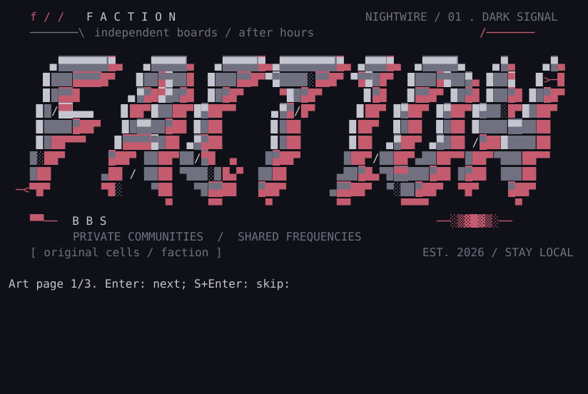

# Faction BBS

**Independent boards. Private communities. Shared frequencies.**

**An independent, terminal-first BBS with a modern foundation and an underground soul.**

Faction brings together the things that made a BBS feel like somewhere: a distinctive ANSI welcome, a sysop's own menus, rooms full of conversation, file areas, late-night chat, and a door into another game. The spirit comes from WWIV, Citadel, and the colorful, heavily customized BBS scenes its founder remembers from the 1980s and 1990s—Vision-X, Vision/2, Oblivion, and the many personal hacks that made each board its own world.

The goal is private, human-scale communities whose operators own their systems and their data. Ordinary SSH terminal access is the initial secure-access direction, with optional private-network-only deployments. A web portal is a future optional access surface; a sysop must be able to keep a board off the public web.

## Status

Try the populated private NetBSD [terminal playground](docs/test-playground.md):
Ghostty/SSH login, Nightwire art, rooms, wall, member pages, chat and Lua demos,
with persistent testing data and guarded start/stop commands. Operator preparation
is required; this is a development preview.

The optional [local sysop console](docs/sysop-console.md) now provides themed
read-only BBS status, live CPU/RAM/network graphs and explicit stale/unavailable health
after OS login. Its [Recovery panel](docs/backup-checks.md) now shows explicitly
recorded complete-bundle checks and preserves the last success when a recheck fails.
Private publication is opt-in; member SSH stays separate.

The [BBS menus and sysop themes](docs/theme-packs.md) now support centered
lightbars and opt-in two-column layouts with sysop-defined entry positions,
directional arrows, ordered Tab and direct hotkeys. Narrow/plain terminals keep
the classic ordered menu. Original CP437 login templates demonstrate bounded
SAUCE/iCE import; the importer emits canonical cells, never raw art controls.
Optional seasonal calendars pin colors/login screens for each approved session.
Opt-in long-form ANSI login art now pages with Enter/skip controls, keeping
classic ASCII recovery. A local authoring preview needs no running board. The
example calendar stays disabled. The optional [original Nightwire artwork](docs/artwork-nightwire.md)
now adds bespoke lettering, a radio-city scene, coordinated seasons and a matching
short/compact identity. [Real-terminal artwork checks](docs/artwork-terminal-compatibility.md)
cover cursor placement and cell widths; pixel/font appearance and owner visual
acceptance remain open.

Optional **[art galleries](docs/scene-gallery.md)** now add curated original/licensed
ANSI/ASCII exhibits, artist/provenance notes and bounded paged viewing. The included
Nightwire collection has readable text editions for classic/narrow terminals;
optional file offers use current local Files permissions. Sysops install/review
packs explicitly; no new schema or public publication.




**Working hobby preview · updated 2026-10-23 · Rust on NetBSD; no supported release yet.**

Faction already runs an approved-membership board with hidden-password login,
ANSI menus, sysop themes, Citadel-style rooms, local command chat, approval/revoke
controls and private export/restore. Arrows/Enter and displayed hotkeys both work.
No JavaScript/TypeScript or public HTTP service is required.
The **[room browser](docs/room-browser.md)** now adds named arrow/hotkey selection,
unread counts, next-unread navigation and room cards for reading/posting without
entering room IDs. Plain terminals and the existing numeric commands remain available.
The optional **[room writing desk](docs/writing-desk.md)** adds multiline paragraphs,
reply quotes, paged preview and explicit send/cancel. Enter `/edit`, then `.screen`
for caret/paragraph editing or keep classic line input. Explicit Save checkpoints
recover local room writing after disconnect; these are plaintext board data,
readable by its sysop. Schema-14 upgrades require a stopped complete backup.
The opt-in **[community wall](docs/community-wall.md)** adds short local ASCII
notes/art, chronological paging, own edits/deletion, sysop moderation and optional
weekly archives. Enable/name it in S:Sysop controls → W:Wall settings; plain and
ANSI terminals share explicit review/send.
Optional **[member pages](docs/member-pages.md)** add bios, interests, original ASCII
signatures, current projects and dated `.plan` history. Members explicitly preview,
share/hide and remove their own content; sysops configure presentation/retention
and moderate without rewriting authorship. Enable through Sysop → Member pages.


Optional **[gatherings and chat nights](docs/gatherings.md)** add a local agenda,
one-off UTC events, counts-only RSVPs, organizer edits/cancellation, sysop moderation,
optional login reminders and deliberate room/chat jumps. Enable through Sysop →
Gatherings; classic and plain terminals share the same workflow. No external calendar.

Optional **[community polls](docs/polls.md)** add local single-choice questions,
explicit ballot review/change/withdrawal, paged text-cell result charts and creator/
sysop controls. Result visibility is configurable; ballots remain operator-readable
local data. Enable through Sysop → Polls; plain and ANSI terminals share the desk.


Optional **[personal catch-up](docs/catchup.md)** brings together the sysop notice,
unread rooms/direct replies, your favorite rooms, eligible files and gatherings.
Enable through Sysop → Catch-up settings. Previews leave room unread unchanged;
visit checkpoints are explicitly saved, with no automatic login tracking. Shared
SSH/native and local/worker desks preserve the classic fallback. Private-mail
content and counts remain outside the server-side desk.


Optional **[Find & save](docs/discussion-search.md)** adds literal discussion
search with room/author filters, current-permission snippets, exact read-only post
views and personal bookmarks. Explicit copyable reference exports keep useful
conversations portable. Enable through Sysop → Find settings; classic/plain and
Unicode-capable terminals share the workflow. Queries are not stored as history,
and these previews never advance room unread markers.


**[Run your first NetBSD board](docs/quickstart-netbsd.md).** Build on the target,
run the first-install preflight/helper, initialize your sysop and explicitly start
the dedicated SSH service. The normal shared backend starts with **eight sessions**.
The installer leaves services disabled and binds loopback unless you choose a
specific interface. You can also [try the local console](docs/local-development.md).

The immediate priority is a useful small board: straightforward setup, an
individual BBS identity, rooms, chat and recovery. The optional
**[Lua arcade](docs/lua-doors.md)** now adds a sysop-editable Doors menu and two
original games: **Signal Hunt** and **Neon Salvage**, with arrows/hotkeys and a
separate game account/evaluator. Local top tens, persistent personal bests,
completed-run counts and an arcade guide give members a reason to return. Scores
survive reconnect/reboot and travel in private exports. Game failure returns to
the board. Optional **[classic server doors](docs/classic-game-doors.md)** now
connect to sysop-selected Telnet endpoints with destination confirmation,
ANSI/CP437 display and a local return key. The connector passed owned-fixture
NetBSD tests. **[Original LORD 4.06 now runs](docs/original-lord.md)** through the
SSH doorway on a separate native NetBSD game VM, with original character creation,
bank gameplay and saved progress. This is a private software proof with one active
game, not a supported public game launcher. TWGS installation reached mandatory
publisher activation, which the owner has deferred. Both original servers and
isolated DOS hosting remain reuse paths, ahead of rewriting.
**[Local file areas and restricted SFTP](docs/file-areas.md)** now add an optional
[F]iles lobby, private-area grants, quota reservations, sysop upload review,
one-file key-bound transfers and complete catalog/blob backup and restore.
The file listener is separate and disabled until the sysop starts it.
The optional **[native terminal client](docs/native-client.md)** keeps transfers in
the BBS flow: select Files, upload/download with local confirmation and progress,
and return to the connected board. Room/chat file links recheck current permissions;
the client can download recently seen links by number. This preview runs on macOS
and native NetBSD; ordinary SSH/manual SFTP remain available.
Optional **[native travel settings](docs/travel-modes.md)** add a local T panel
before connecting: ordinary/compact text and a per-file payload ceiling. Explicit
apply/cancel, direct CLI flags and size deferral keep low-cost visits deliberate;
classic board content and existing transfer approvals remain. Offline exchange
and measured slow-link profiles are follow-on work.
Optional **[library shelves](docs/library-shelves.md)** now organize existing
approved files into sysop-curated collections, with notes, declared rights/provenance
and current-permission file/discussion links. Shared/native Files handoff preserves
recent links and travel ceilings; classic/plain reading remains available. Member
requests and fulfillment remain the next #140 increment.
The owner also selected **[native-client encrypted mail and home identities](docs/private-mail.md)**:
independent invited home servers, member-held keys and local approval at each
visited board. The native client now has an optional [encrypted local vault](docs/local-mail-vault.md)
with hidden unlock, offline recovery, drafts and explicit device pins. Network
inbox/send and roaming authentication remain outside the native product. A
[working two-home protocol experiment](dev-docs/research/0045-encrypted-mail-and-roaming-proof.md)
now passes encrypted subject/body/reply, offline/archive and verified-device refusal
controls, plus scoped native SSH certificate admission. Native OMEMO integration,
incoming mail/history recovery and trusted local identity binding remain #90/#91;
native certificate
signing has a recorded failure under #92. Encrypted attachments stay planned in #88.
The native [board picker](docs/board-launcher.md#open-your-local-offline-vault-between-visits)
can now open that existing offline vault with **M** between visits, using an explicit
member-owned catalog path. Its own hidden local passphrase never goes to a BBS.
The optional **[Other BBSes directory](docs/other-boards.md)** now provides themed
pages and connection cards for sysop-reviewed boards, with independent destination
login/approval. It stays local and never auto-connects or shares keys. Member
submissions, automatic profile import, federation, payments, mesh and browser access
remain backlog work. The **[native board launcher](docs/board-launcher.md)** now lets
members pick their own verified profiles, visit independent boards and return to
the local picker after disconnecting. Every destination still requires local login/approval.
Sysops can customize [themes and original/licensed art](docs/theme-packs.md),
including optional seasonal colors and identity screens.

Native software validation uses a **NetBSD 11 ARM64 VM**. Physical SBCs and other
NetBSD ports remain untested. The maintained service uses base OpenSSH, a separate
terminal identity, private SQLite state and a small native terminal frontend;
[service lifecycle and worker rollback](docs/service-lifecycle.md) remain available.
Read the [security boundary](docs/process-confinement.md) before deployment.

The earlier 250-member memory/admission work is preserved as
[engineering evidence](dev-docs/research/README.md), with
[experimental isolation](docs/experimental-isolation.md),
[key admission](docs/experimental-admission.md) and
[global admission](docs/experimental-global-admission.md) kept separate from normal
setup. Combined-pressure/recovery, host timing, long soaks and independent
privileged-code review stay open. **250 is a research target, not supported
capacity.** These experiments and physical hardware tests do not block building
the ordinary small-board experience.

[Project direction](docs/project.md), [the roadmap](dev-docs/roadmap.md) and
[GitHub Issues](https://github.com/gonz0w/faction-bbs/issues) separate the working
core from future features. Rust/primary NetBSD is selected in
[ADR 0006](dev-docs/decisions/0006-rust-and-primary-netbsd.md); local storage and
identity use SQLite WAL under [ADR 0008](dev-docs/decisions/0008-local-core-and-credentials.md).

The [modern sysop and communications stories](docs/modern-sysop-and-communications.md)
guide the local VM-console dashboard, capability-aware Ghostty-style enhancements,
NetBSD setup/abuse-management workflows and integrated native XMPP notifications.
Real IRC/IRCv3 integration remains research. [Discussion-room posts](docs/discussion-articles-and-news.md)
will use Netnews-style articles, with NNTP-first optional peering and news-provider
subscriptions planned. IRC and encrypted XMPP keep their own formats. The goal keeps the underground BBS character with a modern terminal
experience. The first optional [local sysop console](docs/sysop-console.md) now reads private
aggregate service snapshots, CPU/RAM/network graphs and historical backup checks,
with ANSI/plain panels and stale/unavailable labels. Host actions, peer collectors,
firewall management and new IRC/forum federation protocols remain planned.
An optional [bounded Kitty image preview](docs/kitty-graphics.md) now complements
the terminal settings: T/G probes then streams one original RGB calibration image;
the native client requires local `--kitty` and its own positive probe. Classic
ANSI remains default. [Real terminal profiles](docs/terminal-compatibility.md)
now validate Ghostty, Kitty and Alacritty through local/NetBSD SSH/native routes,
tmux and old screen. Old screen needs classic text; image probes fall back through
both multiplexers. Pixel/glyph certification and rich-art imports remain separate.

The [room reader](docs/room-reading.md) now shares wrapped, paged message screens
across local/worker and shared-service sessions, with theme-aware ANSI transitions
and complete-message unread acknowledgment. A bounded
[Netnews text codec](docs/discussion-articles-and-news.md) is available offline;
[schema-6 post metadata](docs/post-metadata.md) now gives new messages stable
article IDs and recorded UTC times, while legacy dates remain unknown. Members
can now [author subjects and inherit reply defaults](docs/room-articles.md).
Stored posts project into local articles with reserved author/group aliases and
bounded reply references, with strict duplicate/conflict comparison and no
publication. Bodies/replies/unread stay intact and old exports remain readable.
Follow the stopped-service backup/upgrade procedure before opening an older board.
The [v2 article profile](docs/article-profile.md) adds UTF-8 encoded wire subjects,
common dates, plain-text MIME encodings and root/recent reply references. Original
INN passes twelve offline controls on macOS and NetBSD; no news service is enabled.
[Unicode subject composing](docs/unicode-subjects.md) now works in local/worker and
shared terminals with schema-7 metadata, UTF-8-safe reply clipping and inert
classic-terminal echo/previews. [Terminal settings](docs/terminal-capabilities.md)
now opt into native Unicode subjects/room text, cell-aware paging, color depth,
block/braille samples and bounded synchronized redraw with an isolated sync probe.
Classic mode remains the default and immediate fallback. The optional Kitty preview
is separately gated; general bitmap assets, extended input, live NNTP/provider
integration and encrypted network mail remain future work.

A later [hardening phase](docs/later-phase-hardening.md) is tracked in #106–#111:
OpenPGP release/member signatures, a hardened NetBSD VM, post-compromise
containment, protected storage/backups and independent validation. These stories
preserve current safeguards and do not activate a new isolation profile.

## Enter the board

```text
connect -> log in / register -> local sysop approval required
        -> this BBS's ANSI welcome -> message / quote -> main menu
        -> rooms | chat | files | mail | doors | other BBSes
```

- **Approved membership.** Registration requests access; each sysop decides who enters. Community content requires authentication and local approval.
- **Citadel-style message rooms.** Find a room, enter, catch up on new messages, post, and reply. Detailed reply presentation is still being designed.
- **IRC-style conversation.** Command-driven chat begins within one BBS. Channels may stay local. Future shared channels let participating systems subscribe and talk together.
- **Local file areas and mail.** Community resources, messages, and file-sharing policy belong to the local sysop. The native client integrates scoped SFTP in the Files menu; classic terminal transfer protocols remain future adapters.
- **Doors and original games.** Investigate reuse of classics such as TradeWars, including isolated compatibility hosting where appropriate. Ports may follow later. The optional Lua arcade includes two original examples; no legacy title is supported or bundled.
- **A scene of independent boards.** A local Contacts / Other BBSes directory lets operators submit their systems for discovery. Visiting another BBS means entering that system's own membership process.

## The boundaries matter

Each BBS has its own identity, members, rooms, mail, files, games, directory, and rules. **Future cross-board capabilities are participating shared chat, explicitly addressed encrypted mail and scoped home-identity proofs.** Local-only channels, local rooms/community files and local approval stores remain local; visited boards do not receive home mailboxes or decryption keys. [#101](https://github.com/gonz0w/faction-bbs/issues/101) validates NNTP-first opt-in shared discussion rooms; [#103](https://github.com/gonz0w/faction-bbs/issues/103) plans Netnews article formatting and [#104](https://github.com/gonz0w/faction-bbs/issues/104) optional news providers. Formatting does not publish a room; no room export or new protocol is enabled. A separately labeled, deliberate public-publishing room is a new optional research category; it never implies automatic private-room export. A directory listing establishes neither federation nor remote approval.

Privacy, security, lightweight operation, and efficient text interaction are core requirements. Telemetry must be minimal and opt-in. Constrained, intermittent, private, and future mesh networks are research targets; no alternative-network support is claimed today. Public discovery, an HTTP portal, and shared chat must not become prerequisites for operating an independent BBS.

**No JavaScript or TypeScript.** This includes product code, tooling, and browser-terminal dependencies. We will compare fast, lightweight implementation options using evidence and representative prototypes. Browser-console feasibility under this constraint remains an explicit open question; we will not quietly introduce a JavaScript terminal library.

## Find your way

| You want to… | Start here |
| --- | --- |
| Understand the product | [Project direction](docs/project.md) and [session flow](docs/session.md) |
| Understand privacy and access | [Security and privacy requirements](docs/security-privacy.md) |
| Explore the BBS look and feel | [Customization direction](docs/customization.md) |
| Contribute research or implementation | [Contributing](CONTRIBUTING.md) and [development guide](dev-docs/README.md) |
| Work with Codex | [Agent instructions](AGENTS.md) and [workflow](dev-docs/workflow.md) |
| Find work and dependencies | [Issue index](dev-docs/issue-index.md) and [GitHub Issues](https://github.com/gonz0w/faction-bbs/issues) |
| Review architecture decisions | [Decision records](dev-docs/decisions/README.md) |
| Report a vulnerability | [Security policy](SECURITY.md) |

## Build the local core

Use Rust 1.96+ and a native C compiler for the local application. Python 3.10+ and Git support repository checks. The console needs a real Unix terminal; application tests and terminal/recovery workflows also ran natively on NetBSD 11 ARM64. Read the [SSH guide](docs/restricted-ssh.md) before configuring the separate development gateway.

```sh
git clone https://github.com/gonz0w/faction-bbs.git
cd faction-bbs
python3 tools/check_repository.py
cargo build --workspace --locked --release
./target/release/faction --state-dir "$HOME/.faction-dev" init
./target/release/faction --state-dir "$HOME/.faction-dev" login --ansi --theme themes/base
```

See [local development](docs/local-development.md) for member registration, sysop approval, posting, recovery and tests. This owner-capable console opens no listener and must never be used as an SSH forced command. It supports plain text and opt-in ANSI menus; the full BBS experience is still being built. Start contributions with an issue and keep this README and affected docs current.

## License and heritage

Faction BBS is licensed under [BSD-3-Clause](LICENSE). Third-party games, source, fonts, and artwork retain their own licenses; nothing in this repository grants rights to redistribute them. The historical names above describe the founder's inspiration, not affiliation or a claim that their code is included.

Earlier planning used the working name Citadel IRC. Its records are preserved in the [historical archive](dev-docs/archive/README.md); they do not govern current work.
