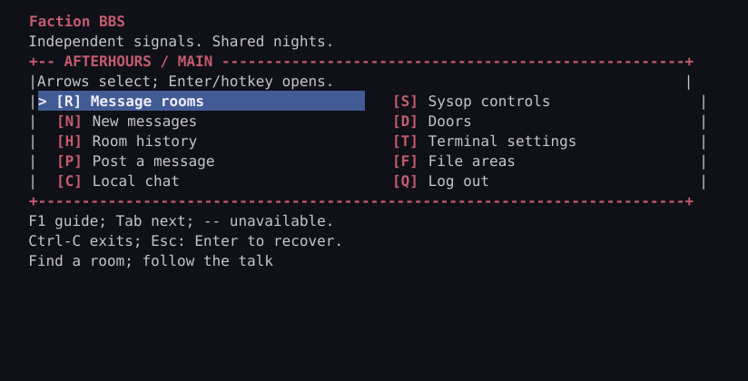
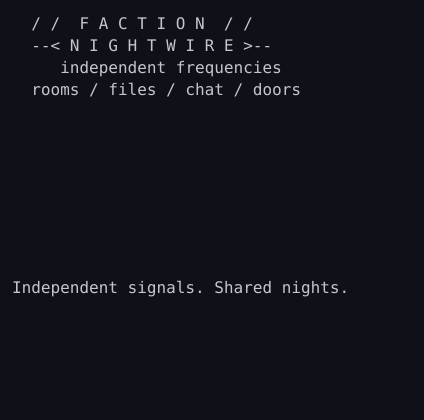
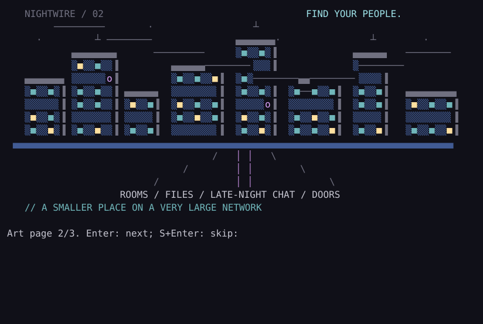
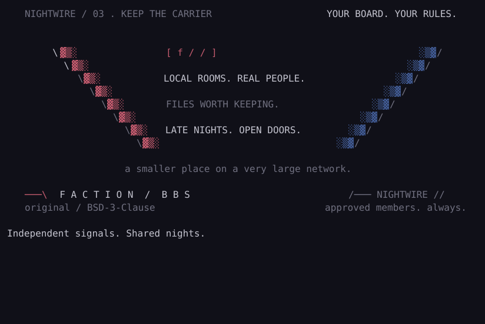
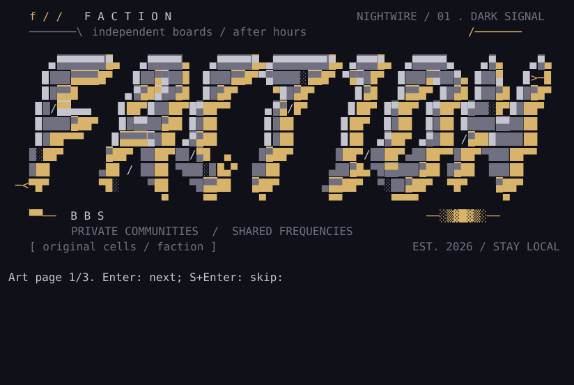
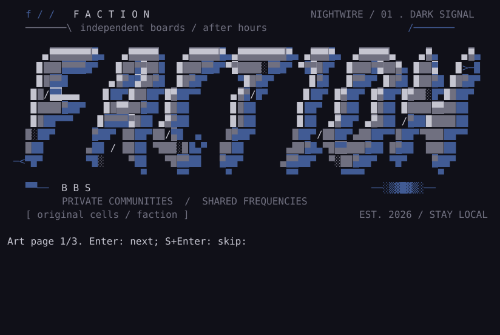

# Nightwire: original ANSI artwork and login screens

Updated 2026-10-22. Original, Codex-assisted artwork candidate for #25; ready to
try through the existing theme system. Owner visual acceptance remains open.


Nightwire gives Faction a coherent nocturnal radio-city identity: a bespoke
slanted/beveled wordmark, rooftop mast and moon, layered city/windows/cables and
an illustrated community receiver. The cyan/magenta/blue palette and deliberate
negative space carry from cover to menu; autumn and winter reuse the composition.
This is original cell artwork, with no archival work, group logo or font generator.
The [reference catalog](../dev-docs/research/0025-menu-and-art-direction.md) remains
attribution for aesthetic study, not a redistribution license.

## Choose a screen

| Pack | Identity | Recovery |
| --- | --- | --- |
| [Nightwire](../themes/nightwire/theme.toml) | Three 80-column / 16-row pages: cover, city and receiver. | Enter-next / S+Enter-skip; fitting ASCII card for compact/plain. |
| [Nightwire short](../themes/nightwire-short/theme.toml) | The same complete cover in one 16-row screen. | Normal welcome/Enter pause; no art paging. |
| [Autumn override](../themes/nightwire-seasons/autumn/theme.toml) | Warm yellow/red/brown variation, three pages; seasonal welcome/card. | Same actions, coordinates, recovery and approval gates. |
| [Winter override](../themes/nightwire-seasons/winter/theme.toml) | Icy cyan/blue variation, three pages; seasonal welcome/card. | Same actions, coordinates, recovery and approval gates. |

The artwork does not enable Doors/Files, change permissions or remap commands.
The two-column main menu retains arrow highlighting, Tab and displayed hotkeys.
Small terminals retain the ordered menu and a compact printable ASCII card.




## Preview and activate

```sh
cargo build -p faction-terminal --example preview_theme --release --locked
./target/release/examples/preview_theme --theme themes/nightwire --login --page 1
./target/release/examples/preview_theme --theme themes/nightwire --login --page 2
./target/release/examples/preview_theme --theme themes/nightwire --login --page 3
./target/release/examples/preview_theme --theme themes/nightwire --columns 40 --login
./target/release/examples/preview_theme --theme themes/nightwire --season themes/nightwire-seasons/autumn --login --page 1
./target/release/faction --state-dir "$HOME/.faction-dev" login --ansi --theme themes/nightwire
```

For the shared NetBSD service, copy the selected pack's `theme.toml`, `login.ans`
and `login.txt` into a private, BBS-owner-owned directory; use the same ownership/
mode and stopped preflight/restart process as the [theme guide](theme-packs.md).
Set the existing root-config `theme` path to that directory. Copy an override into
its own private directory and set `season` if wanted; calendar use follows the
existing disabled-by-default [calendar guide](theme-packs.md#seasonal-calendar-and-login-screens).
The first-install helper still installs the original base. These assets are
opt-in and need no runtime Python, image viewer, JS/TS, new listener or dependency.
Recovery is selecting the earlier valid/base pack and restarting after preflight.

## Source, rights and reproducibility

- Creator: Faction contributors; Codex-assisted original composition and cells.
- License: [BSD 3-Clause](../LICENSE), including these original `.ans`, `.txt` and
  generated preview assets. Preserve its copyright/license notices when sharing.
- Editable source: [build_nightwire.py](../tools/build_nightwire.py). The seven
  letter silhouettes/counters are custom point polygons, with explicit pixels,
  CP437 shading/half-blocks and hand-set scene objects. No raster conversion or
  third-party font/image is an input.
- Encoding: CP437 + the existing bounded CSI subset; SAUCE00 Character/ANSi
  records identify original authorship/extent. Metadata is stripped by the
  product and is not a permission grant for anyone else's art.
- Limits: long 80x48 / three pages; short 80x16. Existing file/page caps, canonical
  controls, approval/epoch checks and shared memory/output limits remain.

```sh
python3 tools/build_nightwire.py             # regenerate only the 12 named new files
python3 tools/build_nightwire.py --check
python3 tools/check_nightwire.py target/release/examples/preview_theme --write-previews
python3 tools/check_nightwire.py target/release/examples/preview_theme
python3 tools/smoke_nightwire.py target/release/faction target/release/faction-member
```

Edit the source, regenerate, then inspect the **product's canonical cell output**.
The checker loads all packs through the compiled product, checks eighteen
wide/compact/plain profiles, short-cover equality, seasonal glyph geometry,
visible foreground/background differences, unchanged menu maps and exact outputs.
It does not automatically judge artistic quality. Optional Python tooling is for
authoring/validation; an installed BBS reads only the prebuilt assets.

## Review the rest of the set






These are reference-palette renders of the actual canonical output, not Ghostty/
other-emulator screenshots or font certification. Terminal palettes and CP437
Unicode glyph metrics can differ; the short/compact/plain paths remain available.
See the [real-terminal compatibility guide](artwork-terminal-compatibility.md) for
measured cell placement, multiplexer viewport requirements and classic recovery.
Review letter readability, silhouette, palette, margins and transition into the
welcome/menu before accepting a board identity. Final owner acceptance, visual
font/palette review, animation and larger art formats remain #13/#25/#29.
Hardening stays later; the preserved playground remains off.
