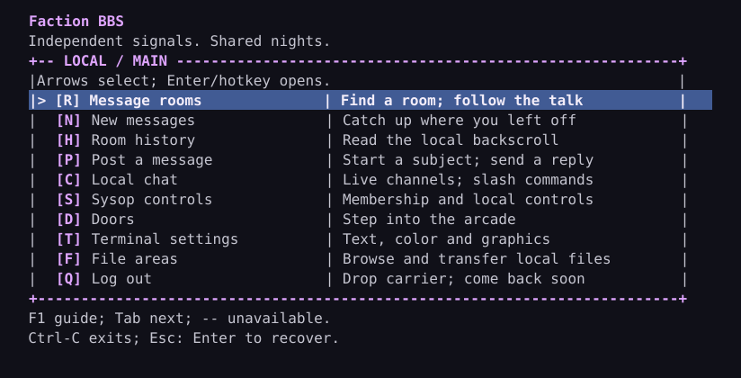
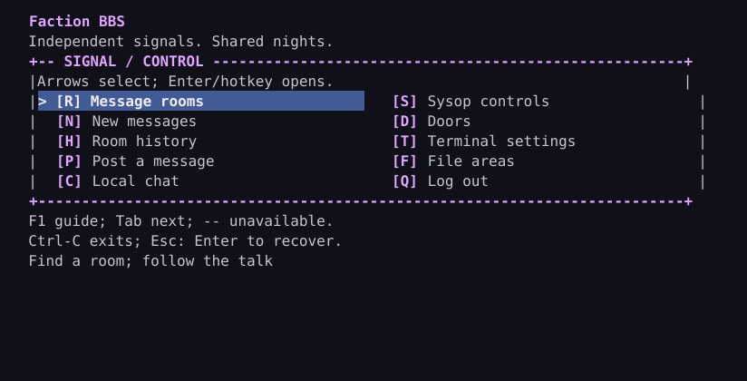
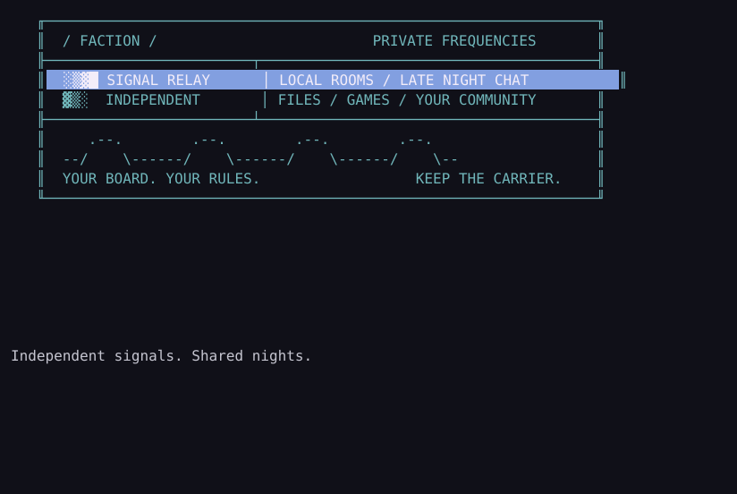
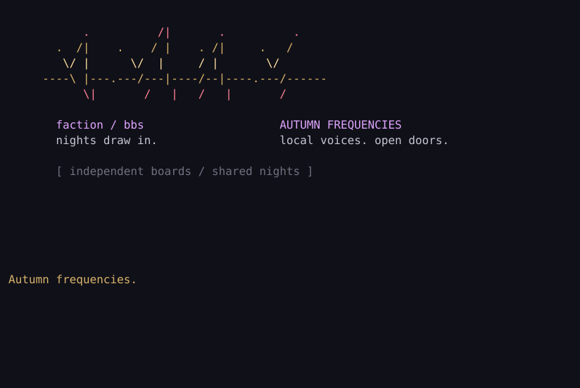
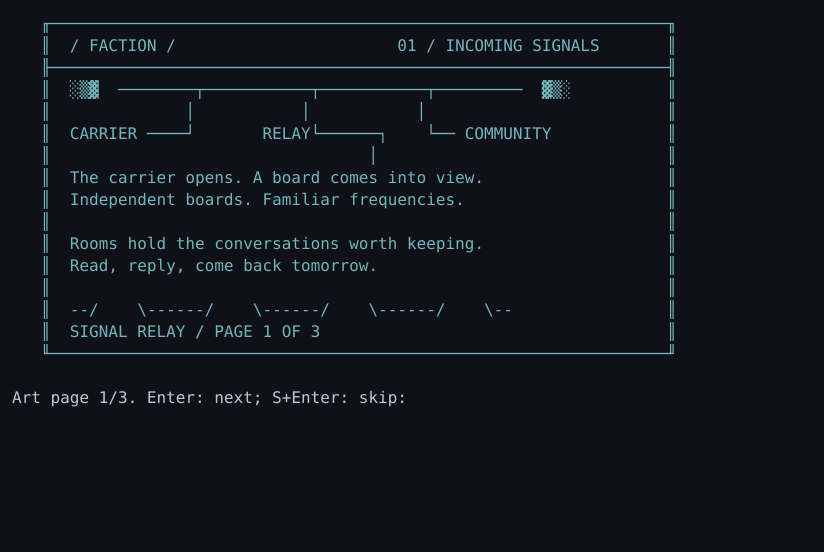
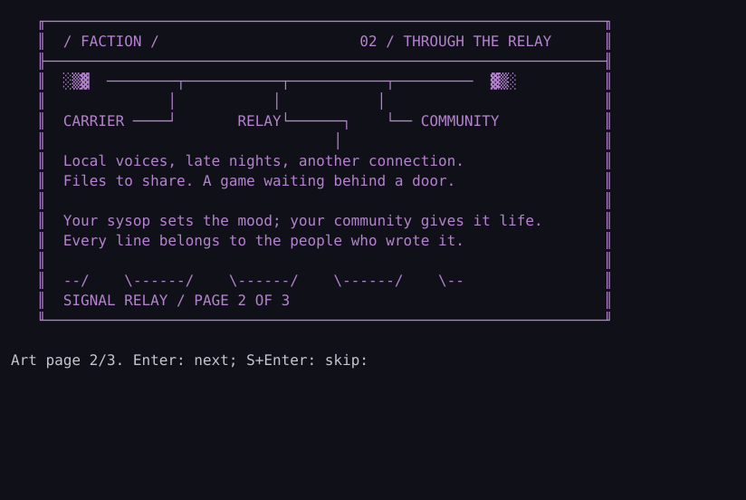
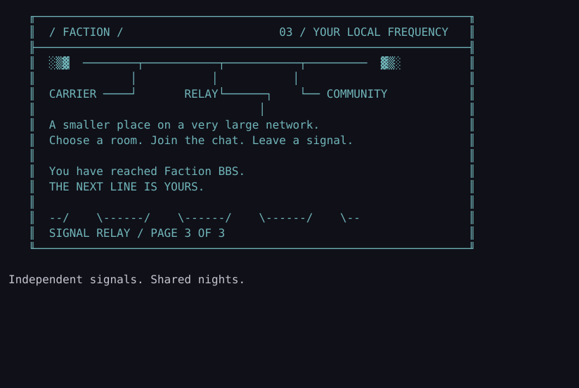

# Local ANSI menus and sysop theme packs

Updated 2026-10-22. Implemented in the local console and trusted SSH member worker; a supported
network release remains work. List/grid menus and bounded identity import are not a complete art editor or
historical terminal emulator. See [build/setup](local-development.md).

```sh
./target/release/faction --state-dir "$HOME/.faction-dev" login --ansi --theme themes/base
./target/release/faction --state-dir "$HOME/.faction-dev" login --ansi --theme themes/base --season themes/seasons/winter
```

Plain text remains the default; use `--plain` explicitly if desired. With `--ansi`,
an approved member sees the configured identity, then the welcome and an Enter
pause, then the menu. Up/Down or Left/Right move the visible `>` focus marker;
Enter opens the selected enabled action. Displayed hotkeys activate directly,
case-insensitively, without Enter. Tab moves forward. Moving focus does not execute.
After a room/sysop action, Enter returns to the menu. Message/editor input is a
separate cooked input context, never dispatched as menu keys.

Sysop controls are disabled for members. Doors are an explicitly unavailable
placeholder in the local console; the shared backend can enable optional Lua
Doors and Files at runtime. A `files` menu entry may choose its own key/label/order.
When installed without an explicit files entry, the host adds `[F]ile areas` before
Quit; a conflicting F key requires a custom files entry. Neither theme action
enables its underlying service. Theme labels/keys/order
do not grant privileges. Every real community action still checks the current
database session/approval/role; revocation is enforced on the next checked action.
This console still has filesystem-owner recovery authority: never expose it as an
SSH forced command, remote shell or member OS account.

## Terminal baseline and recovery

ANSI mode is an explicit assertion that the local terminal understands these
controls. stdin/stdout must be TTYs, `TERM` must be nonempty and not `dumb`, and
geometry must be 40–240 columns by 18–100 rows. Identity ANSI art additionally needs
at least 80x24. Otherwise the console uses the same theme's plain hotkey menu with
Enter. A resize during a menu restores cooked mode and falls back for that action;
the next menu may use ANSI again if geometry is suitable. The main menu itself sends no device queries. Optional Terminal settings have
separate bounded explicit probes; see [terminal capabilities](terminal-capabilities.md). UTF-8 output and a monospaced font with single-cell
CP437-mapped glyphs are assumed for art; ambiguous-width/font/aspect settings can
affect composition. No all-terminal compatibility claim.

Supported arrow input is CSI/SS3 A/B/C/D, optionally `1`; modified/function/mouse
keys are not actions. Sequences have a 16-byte parameter limit and 300-ms completion
deadline. Bare Escape, unknown/malformed/oversized sequences quarantine following
bytes until a line boundary; press Enter to recover. OSC strings drain to BEL/ST,
DCS/APC/PM to ST, even across newlines; Ctrl-C/D exits a stuck menu. CRLF activates
once. Non-ASCII UTF-8 keyboard characters are ignored as whole byte sequences;
their continuation bytes do not become C1 controls. Typeahead is flushed at raw/
cooked transitions, so bytes queued with a selection do not become editor commands.

Normal return/error restores termios, SGR and cursor visibility. Fatal process
termination can still require local terminal recovery (`stty sane`). The local
adapter polls its actual stdin TTY with a 100-ms sleeping timeout to notice resize/
decoder deadlines; it is not the proposed many-member server event loop.

## Format version 1

Copy [the base example](../themes/base/theme.toml) to a directory you own. Packs
are loaded once per login invocation, fully validated in memory, and stay coherent
for that session. Invalid base packs fall back to the built-in text identity/menu;
invalid seasonal overrides retain the entire valid base. No partial activation,
runtime scripts, file writes, shell commands, outbound calls or hot reload. Scheduled
variants are preloaded as one validated catalog; each approved login pins its choice.

`theme.toml` is UTF-8 TOML, at most 8 KiB; this narrow schema also limits opening
brackets to 64 before parsing. Unknown fields/types and unsupported versions fail.
The pack directory and files must belong to the effective OS user, be regular
directory/files, not symlinks, and not group/world writable. Parent directories and
same-UID operator processes are trusted; this is not a hostile-filesystem sandbox.

| Field | Contract |
| --- | --- |
| `version`, `id` | Required version 1; ID is 1–32 lowercase ASCII letters/digits/hyphens. |
| `board`, `welcome`, `logout` | Optional printable ASCII, maximum 36 / 36 / 60 bytes. Built-in defaults fill omissions. |
| `menu_title` | Optional printable ASCII section title, 1–24 bytes; defaults to `Main menu`. Base-only, never a seasonal command-map change. |
| `normal`, `focus`, `hotkey`, `disabled` | Optional inline/style tables: required `fg`/`bg` integers 0–15, optional `bold` boolean. Foreground and background must differ. Numbers use ANSI ordering, including bright 8–15. No raw escape strings. |
| `layout` | Optional base-only `list` (default) or `grid`; grid requires explicit menu entries and coordinates. |
| `[[menu]]` | Optional 6–10 entries, in array/Tab/plain order. Each has `action`, one ASCII alphabetic `key` (unique ignoring case), printable ASCII `label` up to 26 bytes, optional printable ASCII `description` up to 30 bytes. |
| Core actions | Exactly one each of `rooms`, `new`, `history`, `post`, `sysop`, `quit`; optional one `chat` entry enables local chat; optional `doors`, `files` and `terminal` entries expose host capabilities/preferences. Doors/Files availability is decided by the host, never the theme. Unknown/duplicate actions fail. Permissions remain compiled/core-checked. |
| `identity_ascii`, `identity_ansi`, `identity_ansi_long` | Optional simple local filenames, at most 64 bytes, starting with an alphanumeric and containing only letters/digits/dot/underscore/hyphen. No directories or traversal. |
| `creator`, `source`, `permission` | Required printable provenance text (at most 160 bytes each) when an identity file is selected. Record real authorship/rights; text declarations do not prove licensing. |

Older custom version-1 menus can omit chat; add an entry with `action="chat"`,
`key="C"` and a label to expose it. The shipped base includes it.

Omitted art displays the board name as text. No generic block-font logo or archived
artwork is bundled. ASCII identity files allow printable ASCII/CRLF/LF, at most
2 KiB, 80 columns and 16 lines. ANSI files are CP437 bytes, at most 16 KiB, imported
into an 80x16 cell canvas. Glyph bytes 128–255 map to Unicode; 127 uses the DOS
house glyph. Other low control glyphs are unsupported. CR/LF is normalized to
line starts; this is not a byte-perfect ANSI terminal emulator.

The ANSI subset allows SGR reset/bold/normal intensity, basic/bright foreground and
background colors; bounded CSI cursor H/f/A/B/C/D; save/restore s/u; clear J=2 and
erase-to-end K=0. Out-of-canvas movement, other controls, OSC/DCS/device/clipboard/
window operations, raw blink and extended/RGB colors fail the whole pack. Only the
SAUCE non-blink flag enables SGR 5/25 as canonical bright-background changes. Original
escape bytes never reach the terminal. Rendering uses only canonical local SGR,
bounded cursor positioning and known glyphs, capped at 16 KiB output.

SAUCE00 Character/ANSi trailers are accepted within the same total 16 KiB file
limit. Width must be unspecified (0) or 80; height must be 0–16. EOF must immediately
precede the optional correctly sized `COMNT` block and final 128-byte record.
Other versions/types, malformed blocks, reserved flags or oversized dimensions
reject the pack. FileSize is advisory and ignored; all metadata is stripped, never
printed or treated as licensing. Non-blink flag bit 0 permits SGR 5/25 as bright
background on/off, including subsequent basic background changes. Output uses
100–107 backgrounds, never terminal blink. Font/spacing/aspect hints are ignored;
terminal font metrics are outside this import profile. SAUCE is not permission.

Animation, larger art profiles, arbitrary grids and per-room styling remain under
#13/#25/#29. Do not call the importer compatible with every archived art pack.
The rights/provenance and [art direction](menus-and-themes.md) requirements still
apply to every actual identity screen.

## Seasonal overrides and measured redraw

`--season` selects an override explicitly at next login. [Autumn](../themes/seasons/autumn/theme.toml)
and [winter](../themes/seasons/winter/theme.toml) are examples, not a default calendar
or hemisphere assumption. Overrides may set version/ID, welcome, styles, identity
files and their provenance. They cannot change board name, menu labels, keys,
actions or order. Missing fields retain the base; any invalid field/file rejects
the entire override. Optional annual scheduling is now available below; existing sessions keep their chosen theme.

The default list menu uses the actual TTY width: 40–79 columns selects a centered 38-cell
compact panel; 80–240 selects a centered 76-cell panel with action descriptions.
Both use the same vertical action order, Up/Down/Left/Right/Tab navigation,
Enter/direct hotkeys and current authorization. A 10-entry menu fits in 18 rows.
No keyboard action or service is added by a description. Unavailable actions show
`--` in compact mode and `(unavailable)` in wide mode. The `>` marker stays visible
without color; focus covers the whole row, including the hotkey background.
The fixed help/recovery instructions cannot be overridden by a pack.

The built-in nine-entry compact menu emits 1,224 UTF-8 bytes; its first focus
move emits 170 bytes. The maximal-text ten-entry fixture measures 1,311–1,974
bytes for a full screen and 170–248 for a two-row focus update across 40, 79, 80,
132 and 240 columns. Focus movement never replays login art or clears the screen.
Regression ceilings are 4 KiB per full menu and 512 bytes per focus update;
these are renderer output budgets, not latency, resident-memory or capacity claims.
The shared queue/drain and normal eight-member admission defaults stay unchanged.

New fields are additive to version 1: existing packs load with a default title
and no descriptions. Older binaries reject a pack using new fields rather than
partly applying it. Keep a matching older pack when rolling back a binary. Each
startup/login selects one validated snapshot; there is no mid-session reload.

The [shared UI candidate](shared-ui.md) reuses this validator, safe CP437 importer
and menu renderer for all members through one immutable owner snapshot. Select
the base then manual season at owner startup; a restart changes the shared
snapshot. Invalid explicit packs fail startup before binding. Normal local-console
fallback behavior above is unchanged. Native theme/plain/resize/editor checks and
three short 250-member VM workloads pass; automatic scheduling, hot reload and
commissioned scene artwork remain separate work.

The optional `terminal` menu action opens session-only [terminal settings](terminal-capabilities.md).
Add it with a free hotkey (the current base example uses T). Existing custom
layouts are not remapped automatically. Rich color headers use the sysop's
existing 16-color palette; this does not widen trusted art or theme-text formats.

## Preview and customize without a live board

The shipped base uses a violet accent and blue lightbar; autumn and winter are
manual palette/welcome overrides. Menu chrome and descriptions are original
Faction work under BSD-3-Clause. They are not a commissioned identity screen or
redistributed scene artwork. Identity assets still require their own provenance.



These SVGs use a fixed illustrative 16-color reference palette; a terminal's own
palette/font changes the appearance. [Compact](images/menu-compact.svg) and
[autumn](images/menu-autumn.svg) previews come from the same renderer. They are
cell-layout previews, not emulator screenshots or glyph/pixel certification.

Build the optional local authoring example:

```sh
cargo build -p faction-terminal --example preview_theme --release --locked
./target/release/examples/preview_theme --theme themes/base --columns 80
./target/release/examples/preview_theme --theme themes/base --columns 40 --plain
./target/release/examples/preview_theme --theme themes/base --season themes/seasons/autumn
python3 tools/render_theme_preview.py target/release/examples/preview_theme --theme themes/base --output /tmp/faction-menu.svg
```

The preview validates the whole pack and fails on errors. It uses no board,
credentials, account permissions or listener. For authoring it shows sysop,
Doors and Files as available; it does not enable those services on a live board.
The SVG tool needs only Python's standard library and rejects terminal controls
outside the menu's canonical positioning/16-color grammar. Product builds do not
need it. Use an empty terminal at least as wide/high as the chosen preview.

For a custom layout, copy the base pack, change `menu_title`, labels/descriptions,
colors and order, then validate the copy. Retain the required core actions, unique
keys and fixed action names. Restart the shared owner after checking a stopped
configuration; don't edit an active session's action mapping. A season changes
only its allowed palette/welcome/identity fields; base descriptions and title stay
coherent. Calendar scheduling is described below. Larger/animated art and native visual
acceptance of original/authorized scene identity art remain #25 follow-ups.

## Custom grid layouts and CP437 art

Copy the opt-in [grid example](../themes/grid/theme.toml); the first-install helper
still installs the base list. Set `layout="grid"` and give **every** `[[menu]]` entry
an integer `row` (1–5) and `column` (1–2), with no duplicate cell. Entry array order
remains the plain/compact reading and Tab order; coordinates only place wide ANSI
cells. Empty cells are allowed. Coordinates without grid, missing/invalid positions
and seasonal layout overrides reject the whole candidate. Host-enabled Files can
fill the first unused row-major cell if omitted; an explicit Files entry gives
complete control. Files/Doors/Sysop remain unavailable without host/role approval.

At 80–240 columns the 76-cell panel contains two columns. Up/Down wrap through
enabled entries **in the current column**. Left/Right move to the other column,
preferring the same row, then nearest row, with the upper row breaking ties. If
there is no enabled destination, focus stays. Tab visits all enabled entries in
array order; Enter and printed hotkeys activate the same core-checked actions.
A visible `>` identifies focus; disabled entries have `--`. The selected action's
optional description appears below the panel. Every grid fits the existing
18-row minimum. At 40–79 columns it becomes the classic ordered 38-cell list;
plain mode retains text/hotkeys. No new capability probe is required.

Only the old/new cells and description redraw on movement, within the existing
512-byte update budget; full menu stays below 4 KiB. Shared sessions keep an
entry index, not a theme/art copy. Seasons preserve grid coordinates and action
maps. Restart the owner after validating a stopped config to activate changes.

```sh
./target/release/examples/preview_theme --theme themes/grid
./target/release/examples/preview_theme --theme themes/grid --columns 40
./target/release/examples/preview_theme --theme themes/grid --login
python3 tools/render_theme_preview.py target/release/examples/preview_theme --theme themes/grid --login --output /tmp/faction-grid-login.svg
```




The template is original, Codex-assisted BSD-3-Clause sample linework, not a final
identity or redistributed artscene work. Previews use a reference palette and
known CP437-to-Unicode glyphs; they are not terminal/font screenshots. The
[SAUCE specification](https://www.acid.org/info/sauce/sauce.htm) defines the record
and non-blink flag; our narrower import profile above still applies. Rendered
CP437 glyph widths can depend on the terminal/font; use ASCII/plain recovery.

## Seasonal calendar and login screens

The [example calendar](../themes/seasons/schedule.toml) ships **disabled**. Copy the
base, seasonal directories and calendar as BBS-owner files; the first-install
helper currently installs only the base pack. The supplied date ranges are
illustrative, and you should choose your own calendar and timezone.

```sh
./target/release/faction --state-dir "$HOME/.faction-dev" login --ansi --theme themes/base --theme-schedule themes/seasons
```

For the normal shared service, set the optional root-owned `service.toml` field:

```toml
theme = "/var/db/faction/themes/base"
theme_schedule = "/var/db/faction/themes/seasons"
# season = "/var/db/faction/themes/seasons/winter" # manual override wins
```

For an existing board, stop admission and drain/stop the backend before installing
packs or changing configuration. From your reviewed source checkout, install the
new examples explicitly (operator privileges, service left stopped):

```sh
install -d -o factiond -g factionipc -m 700 /var/db/faction/themes/seasons
install -o factiond -g factionipc -m 600 themes/seasons/schedule.toml /var/db/faction/themes/seasons/schedule.toml
for season in autumn winter; do
  install -d -o factiond -g factionipc -m 700 "/var/db/faction/themes/seasons/$season"
  install -o factiond -g factionipc -m 600 "themes/seasons/$season/"* "/var/db/faction/themes/seasons/$season/"
done
```

Review `enabled`, dates and timezone as factiond, then run the normal config
preflight as factiond using `/usr/local/libexec/faction-service --check-config /etc/faction/service.toml`. Restart the backend, then admission, only
after success. See [normal setup/restart](quickstart-netbsd.md). The member worker
also accepts `--theme-schedule`; the rollback rc path retains its existing manual
arguments unless the operator explicitly supplies the fixed calendar option.
No command or calendar date comes from a member's terminal. System mode trusts the
server's OS/zone data; libc may use UTC if those rules are unavailable. Confirm the
intended zone with the authoring timestamp preview before enabling the calendar.

The separate `schedule.toml` is UTF-8, <=8 KiB, with the same owned regular-file,
non-symlink and write-permission rules as a theme. It contains only:

| Field | Meaning |
| --- | --- |
| `version = 1` | Required supported calendar format. |
| `enabled` | Required boolean. False uses the base and skips loading seasonal assets; metadata still validates. |
| `timezone` | Required `"UTC"` or `"system"`. System uses the trusted server's local rules, including DST. Ordinary service startup uses the OS timezone; per-board named-zone strings are not accepted. |
| `[[season]]` | Zero to eight entries. Each `pack` is a unique 1–32 character lowercase letter/digit/hyphen directory name immediately under the calendar directory. |
| `start`, `end` | Required `MM-DD`; start inclusive, end exclusive. `12-01` to `03-01` wraps across New Year. Equal boundaries are rejected. Feb 29 is valid and matches only actual leap dates. |
| `priority` | Required integer 0–255; highest matching priority wins. Same-priority overlapping windows reject the whole calendar, independent of file order. |

For example, a short high-priority holiday window can override a longer winter
window without changing any menu commands. There is no hemisphere or holiday
built into the scheduler. No match or unavailable/out-of-range clock uses the
base theme. `season`/`--season` selects one manual override and bypasses the entire
calendar, including a missing/broken file. To return to the base, remove the manual
setting and disable the calendar or remove its configuration field.

The shared owner loads and validates every enabled pack **before binding**. A bad
calendar/asset makes explicit shared/worker configuration fail; fix it, disable it
or select a valid manual override. Local-console errors warn and retain the whole
valid base. Nothing partially changes. Each approved login chooses one immutable
theme for identity, welcome, menus, posts, chat and doors; active sessions and drafts
never switch at midnight. New logins see the current date from the same preloaded
catalog. Editing files requires a restart, even for later logins.

The shared catalog holds at most nine themes once. Each shared member stores only an
index; there is no per-member art copy, calendar timer, file polling, new helper
or new external dependency. The existing native bridge supplies presentation-only
UTC/system dates; it never changes TZ, the host clock, account approval or mail keys.
The worker rollback has a separate catalog per process. Credential, queue/drain
and admission limits remain the same. This is not a new
250-user memory/capacity measurement.

### Original login templates and classic recovery

Autumn and winter now include original ANSI and compact ASCII login templates
with explicit BSD-3-Clause provenance. They are editable functional examples,
not accepted final scene identity art or historical ACiD/iCE/Razor reproductions.
They use the existing CP437/basic-SGR importer; raw source escapes are never sent.



[Winter](images/login-winter.svg) and [compact ASCII](images/login-compact.svg)
use the same trusted identity presenter. At ANSI 80x24 or larger it renders the
validated 80x16 art. Smaller supported terminals get a fitting ASCII identity;
plain mode never emits escapes. Too-wide/tall ASCII or unknown geometry uses the
board name. The welcome/pause follows the identity only after local approval. Full and
fitting compact ANSI cards wait for Enter; plain CLI output keeps line mode.
The calendar never adds a pre-auth community screen or a graphics passthrough.

Preview without changing the clock or running a board:

```sh
./target/release/examples/preview_theme --theme themes/base --theme-schedule themes/seasons --date 2026-12-20 --login
./target/release/examples/preview_theme --theme themes/base --season themes/seasons/winter --columns 40 --login --plain
python3 tools/render_theme_preview.py target/release/examples/preview_theme --theme themes/base --season themes/seasons/autumn --login --output /tmp/faction-login.svg
```

Enable your copied calendar to exercise dates; the shipped disabled example stays
on base. `--date`/`--timestamp` are authoring-example controls only, never member
or daemon arguments. SVG rendering covers ASCII template glyphs with a fixed
reference palette; use the terminal preview for other supported CP437 glyphs.
The examples/previews do not certify a particular emulator/font or final art.
Keep matching older service configuration/CLI flags when rolling back to a binary
that predates `theme_schedule`; no database migration is involved. Back up calendar,
packs and configuration with your complete board backup.

## Long-form login art and paging

Set **`identity_ansi_long="login.ans"`** to opt into the
[original three-page example](../themes/longform/theme.toml). It is mutually
exclusive with `identity_ansi` in the same pack. Keep `identity_ascii` for smaller
terminals and declare actual `creator`/`source`/`permission`. Both base and seasonal
packs accept the long field; an override replaces the selected ANSI asset without
moving menu entries or changing actions. Existing short `identity_ansi` stays
80x16 / 16 KiB, including its stricter metadata dimensions.

The long profile allows **80x256 cells** and **64 KiB total file**, including SAUCE
and comments. Width remains 0/80 in SAUCE; declared height must fit the selected
profile. The asset's actual/declared extent determines 1–16 pages. Every page
validates before activation, including later controls and output amplification.
Each page emits at most **16 KiB of canonical art**, using only 16-color SGR, local
cursor coordinates and CP437 glyphs. Raw controls/metadata never pass through.
There is no animation, automatic scrolling, arbitrary width or network fetch.

After approval, at ANSI 80x24 or larger, art appears **16 rows at a time**:
Enter advances; **S then Enter** skips the remaining art to the ASCII welcome.
The final page leads to the normal welcome and Enter-to-menu pause. Other typed
letters stay pager input and cannot activate a menu action. Input is bounded;
coalesced typeahead is flushed at transitions. Compact/plain sessions get the
fitting ASCII card or board name, without paging. Classic ANSI requires no modern
graphics negotiation. A shared session resizing during paging falls back after
its current output drains; local/worker sessions do so at the next input boundary.
Approval/epoch checks apply before each new page and menu entry; revocation does
not permit another page.

All art lives in the startup theme catalog. A shared member retains a page index;
only the requested page is rendered/queued, with existing 32 KiB output and
five-second drain rules. The importer temporarily allocates a bounded canvas and
trims unused extent. Short assets keep short storage; large art never becomes a
whole-art per-member cache. Calendar/manual pinning and restart/preflight recovery
remain unchanged. To roll back, select the base/short pack and restart after
preflight. The installer does not enable this example automatically.

```sh
./target/release/examples/preview_theme --theme themes/longform --login --page 1
./target/release/examples/preview_theme --theme themes/longform --login --page 2
./target/release/examples/preview_theme --theme themes/longform --login --page 3
python3 tools/render_theme_preview.py target/release/examples/preview_theme --theme themes/longform --login --page 2 --output /tmp/faction-login-page.svg
```

The authoring preview allows 17 KiB including framing/prompt overhead.
Preview page numbers are 1-based and require `--login`; unavailable pages fail,
including page 2 in compact/plain mode. The product never accepts a member-supplied
asset path or date through this authoring interface.





These are original Codex-assisted BSD template pages and reference-palette cell
renders, not final accepted scene identity or terminal/font screenshots. Historical
art still needs actual permission; importing SAUCE provides none. Larger/animated
art and final original/licensed artistic acceptance remain #13/#25/#29 work.

## Original Nightwire artwork

The [Nightwire art guide](artwork-nightwire.md) provides a cohesive original
radio-city identity, bespoke lettering, three-page/short variants, seasonal
palettes and matching compact cards. Select a complete pack or its manual
seasonal override using the existing options. These are new opt-in assets; no
runtime parser, default installer, menu mapping or previously measured pack
changes. Follow the guide for provenance, editing/reproduction and visual review.

Optional `writing_title = "Night Desk"` in a base/seasonal theme names the
[room writing surface](writing-desk.md). It is limited to 24 printable ASCII bytes;
the room destination and subject remain explicit. The current palette applies.

The optional [community wall](community-wall.md) accepts `action = "wall"` with a
custom key/label/description. A theme cannot enable it; use sysop Wall settings.
When more than eleven entries need ordered rendering, a nine-row lightbar window
scrolls with focus, keeping the recovery footer inside 40×18. All hotkeys remain
active, and plain menus list every action. Existing smaller menus are unchanged.

Optional [member pages](member-pages.md) declare `action = "member_pages"` with a
custom key/label/description. Sysop settings control enablement, card/compact layout
and page title; the trusted session palette supplies colors. Themes grant no access.


Optional [gatherings](gatherings.md) declare `action = "gatherings"` with a free
letter, label and description. The host enables it only when the sysop policy is
on; the default action is G. Crowded/narrow menus retain the ordered scrolling
fallback, main arrows/Enter and direct hotkeys. Agenda commands use Enter.


Optional [polls](polls.md) declare `action = "polls"` with a free key, label and
inert description. The host inserts V when enabled and prevents a declared action
from enabling disabled policy. Results use bounded ASCII `#` bars/numeric counts,
so a modern graphics terminal is optional. Crowded menus keep classic scrolling.


Optional [catch-up](catchup.md) declares `action = "catchup"` with a free key,
label and description. The enabled host inserts U otherwise; it stays unavailable
when disabled. Sysop S/U controls its heading, compact/cards, module order and local
notice. Existing palette, crowded-menu scrolling and plain fallback remain.


Optional [Find & save](discussion-search.md) declares `action = "find"` with a free
key/label/description. The enabled host inserts B otherwise; disabled capability
stays unavailable. Sysop S/B sets heading/cards/compact. Snippets/source views
inherit trusted presentation and existing classic/Unicode rules; no raw member
control becomes theme authority.


## Curated gallery packs

See [the gallery guide](scene-gallery.md) for the optional owner-managed startup
pack, current-approval file links, canonical ANSI/text editions and rights review.
Gallery packs are external host configuration, preserved separately from database
exports/bundles. No new schema, public service or raw uploaded graphics authority.


## Curated library shelves

[Library shelves](library-shelves.md) layer owner-reviewed notes/collections over
current local file publication/grants. Hidden sources expose no captions, shelf
names or tokens. Transfers/discussion use existing authorized workflows; browsing
alone never advances unread. Packs are external config to preserve separately
from complete DB/blob backups. Schema remains 14; no new transfer authority.
